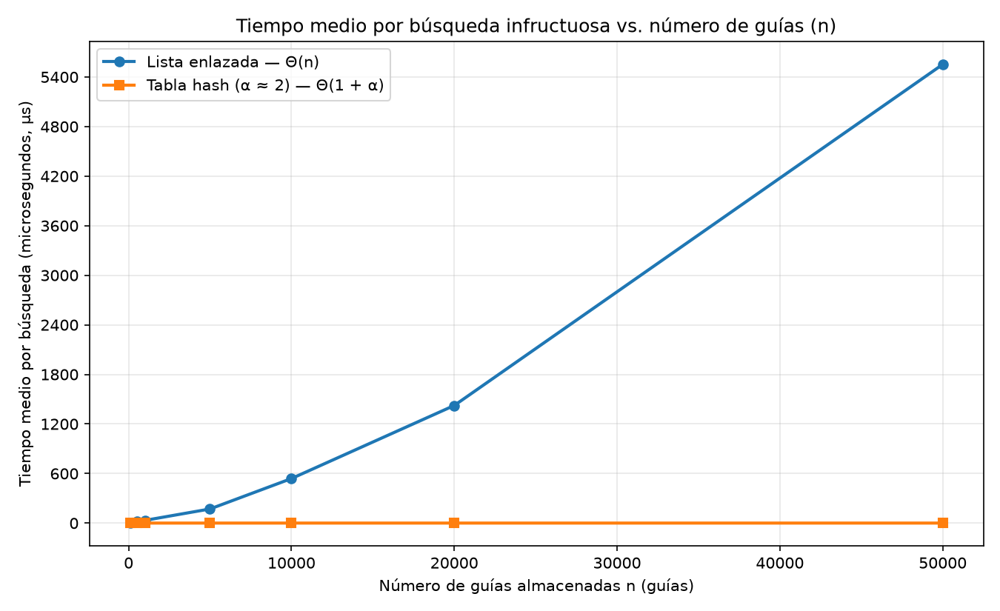
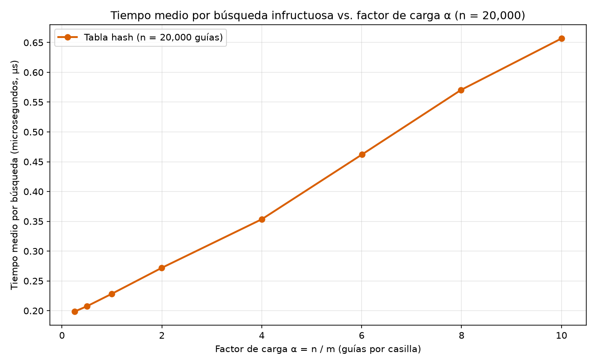

# Laboratorio #3 estructuras de datos

**Nombre:** Pablo Tabares Cardona

## Cómo reproducir el experimento

Este laboratorio esta en `laboratorios/lab3-estructuras-datos/`. Para ejecutarlo correctamente hay que situarse en esa carpeta antes de correr los scripts

**1. Ir a la carpeta del laboratorio**

```bash
cd laboratorios/lab3-estructuras-datos
```

**2. Crear el entorno virtual**

```bash
python -m venv .venv
```

**3. Activarlo**

- Windows (CMD): `.venv\Scripts\activate`
- Windows (PowerShell): `.\.venv\Scripts\Activate.ps1`
- Windows (Git Bash): `source .venv/Scripts/activate`
- Linux y macOS: `source .venv/bin/activate`

**4. Instalar las dependencias del proyecto**

El repositorio define las dependencias en la raíz (`requirements.txt`), así que desde la carpeta del laboratorio puede ejecutarse:

```bash
python -m pip install -r ../../requirements.txt
```

**5. Ejecutar las pruebas**

```bash
python pruebas.py
```

Si todo está bien, imprime `Todas las pruebas pasaron.`

**6. Ejecutar la medición**

```bash
python medicion.py
```

Se imprime en consola las tablas de resultados de los Experimentos A y B y guarda las gráficas en la carpeta `graficas/` dentro de este laboratorio.

---

## Parte 1 — Implementar y verificar las dos estructuras

Código: [`estructuras.py`](estructuras.py) · Pruebas: [`pruebas.py`](pruebas.py)

Para comprobar que la lista enlazada y la tabla hash funcionan bien y responden lo mismo, `pruebas.py` cubre los siguientes casos:

- Lista y tabla vacías (tamaño cero, factor de carga en cero y búsqueda que devuelve `None`).
- Las cuatro guías de ejemplo de *Rutas del Caribe* (`1000000010`, `1000000024`, `1000000017` y `1000000005`), probando búsquedas de guías que sí están y de guías que no existen.
- La colisión forzada con `m = 7` y las guías `10`, `24` y `17`: comprueba que las tres caen en la casilla `3`, que esa lista queda con tamaño `3`, que las tres se pueden buscar después sin perderse y que `factor_carga()` da `3 / 7`.
- 30 colecciones aleatorias (con semilla fija `42`) de distintos tamaños y números de casillas, verificando que la lista y la tabla devuelven exactamente el mismo resultado tanto para guías existentes como para guías inexistentes.

---

## Parte 2 — Medir y graficar

Código: [`medicion.py`](medicion.py)

### Experimento A — Lista frente a tabla



### Experimento B — Efecto del factor de carga



**Medición:**

- **Experimento A:** se midieron los tamaños `n` de 100, 500, 1000, 5000, 10000, 20000 y 50000 guías. Para cada `n` se usó un `m` primo cercano a `n / 2` (47, 251, 499, 2503, 4999, 10007 y 24989), para que el factor de carga $\alpha$ se mantuviera siempre cerca de 2.
- **Experimento B:** se dejaron fijas `20000` guías y se cambiaron las casillas `m` (79999, 40009, 19997, 10007, 4999, 3331, 2503 y 1999) para probar valores de $\alpha$ desde `0.25` hasta `10`.
- Las guías son números únicos de diez dígitos creados con semilla fija (`42`), usando **las mismas guías** en las dos estructuras. En cada punto se hacen 200 búsquedas de guías inexistentes generadas con semilla `7`.
- Se cronometran solo las búsquedas con `time.perf_counter()`; crear los datos y llenar las estructuras queda fuera del reloj (primero se construyen todas las estructuras y después se mide). El lote de 200 búsquedas se repite hasta 5 veces en la lista para tamaños pequeños y 150 veces en la tabla, guardando el menor tiempo medio por búsqueda.
- Dentro del experimento se verifica con `assert` que la lista y la tabla entregan el mismo estado para una muestra de guías existentes.

**Resultados en consola — Experimento A:**

| n | m | alfa | Lista (µs) | Tabla (µs) | Lista/Tabla | x n | x Lista | x Tabla |
|---:|---:|---:|---:|---:|---:|---:|---:|---:|
| 100 | 47 | 2.13 | ~2.5 | ~0.27 | ~9 | - | - | - |
| 500 | 251 | 1.99 | ~13 | ~0.27 | ~48 | 5.0 | ~5.2 | ~1.00 |
| 1000 | 499 | 2.00 | ~27 | ~0.27 | ~100 | 2.0 | ~2.08 | ~1.00 |
| 5000 | 2503 | 2.00 | ~170 | ~0.27 | ~630 | 5.0 | ~6.3 | ~1.00 |
| 10000 | 4999 | 2.00 | ~538 | ~0.27 | ~1990 | 2.0 | ~3.16 | ~1.00 |
| 20000 | 10007 | 2.00 | ~1417 | ~0.27 | ~5250 | 2.0 | ~2.63 | ~1.00 |
| 50000 | 24989 | 2.00 | ~5550 | ~0.27 | ~20560 | 2.5 | ~3.92 | ~1.00 |

**Resultados en consola — Experimento B (`n = 20000`):**

| m | alfa | 1 + alfa | Tabla (µs) | x (1+alfa) | x Tabla |
|---:|---:|---:|---:|---:|---:|
| 79999 | 0.25 | 1.25 | ~0.198 | - | - |
| 40009 | 0.50 | 1.50 | ~0.207 | 1.20 | ~1.05 |
| 19997 | 1.00 | 2.00 | ~0.228 | 1.33 | ~1.10 |
| 10007 | 2.00 | 3.00 | ~0.272 | 1.50 | ~1.19 |
| 4999 | 4.00 | 5.00 | ~0.353 | 1.67 | ~1.30 |
| 3331 | 6.00 | 7.00 | ~0.462 | 1.40 | ~1.31 |
| 2503 | 7.99 | 8.99 | ~0.570 | 1.28 | ~1.23 |
| 1999 | 10.01 | 11.01 | ~0.657 | 1.22 | ~1.15 |

---

## Parte 3 — Análisis

### 1. Costo teórico

En la lista enlazada no hay atajos ni orden: cada nodo solo apunta al siguiente. Si se busca una guía inexistente, toca recorrer desde la cabeza hasta `None`, mirando las $n$ guías una por una; por eso cuesta **$\Theta(n)$**.

La tabla hash calcula la casilla con $h(k) = k \bmod m$ y va directo a ella en un paso fijo (el **$1$**). Ahí solo recorre la lista de esa casilla, que en promedio tiene $\alpha = n / m$ guías; sumando ambos pasos, cuesta **$\Theta(1 + \alpha)$**. Esto se apoya en el supuesto de **hashing uniforme simple**: que la función hash reparta las guías de forma pareja, dándole a cada casilla la misma probabilidad ($1/m$). Si todas las guías cayeran en la misma casilla, esa lista tendría tamaño $n$ y las demás quedarían vacías; la tabla se volvería una lista enlazada y tardaría **$\Theta(n)$**.

### 2. Lo medido contra lo esperado

En `lista_vs_tabla.png`, la lista (azul) sube como una rampa y la tabla (naranja) se queda pegada al piso. Al duplicar `n` de `500` a `1.000` ($\times 2,0$), la lista sube de `~13 µs` a `~27 µs` ($\times 2,08$) y la tabla se mantiene en `~0,27 µs` ($\times 1,0$). Entre `10.000` y `20.000` ($\times 2,0$), la lista sube de `~538 µs` a `~1.417 µs` ($\times 2,63$) y la tabla sigue en `~0,27 µs`. Las lecturas tienen ruido y la curva de la lista es algo más empinada que una recta pura (probablemente por efectos de caché al crecer la memoria), pero en conjunto, de `500` a `50.000` guías ($n$ se multiplica por 100), la lista pasa de `~13 µs` a `~5.550 µs` (muy por encima de 100 veces) y la tabla se queda en `~0,27 µs` (no crece). Esto es coherente con que la lista crece al menos linealmente en $n$ ($\Theta(n)$) y la tabla es $\Theta(1)$ con $\alpha \approx 2$.

En `tiempo_vs_alfa.png` (`20.000` guías fijas), al crecer $\alpha$ de `0,25` a `10` el tiempo sube casi en línea recta de `~0,198 µs` a `~0,657 µs`. Es coherente con $\Theta(1 + \alpha)$: parte de un piso de `~0,19 µs` (calcular el hash y abrir la casilla, el `1`) y suma `~0,05 µs` por cada unidad de $\alpha$.

### 3. Explique las colisiones

Una colisión pasa cuando dos guías distintas dan el mismo índice en la función hash y van a la misma casilla. Ocurre aunque haya más casillas que guías porque millones de posibles guías de diez dígitos se reparten en pocas casillas: basta con que la resta entre dos guías sea múltiplo de $m$ para que tengan igual residuo. Con `m = 7`, las guías `10`, `24` y `17` dejan residuo `3` al dividirlas entre `7`, cayendo las tres en la casilla `3` aunque queden seis casillas vacías.

- **Encadenamiento:** la casilla `3` enlaza los tres nodos (`17 -> 24 -> 10`). *Ventaja:* no se llena, admite $\alpha > 1$ y borrar es sencillo. *Costo:* memoria extra en punteros y peor localidad de caché.
- **Direccionamiento abierto:** guarda todo en el arreglo; al colisionar en `3`, `24` y `17` buscan otra casilla vacía por sondeo (`4`, `5`...). *Ventaja:* sin punteros y mejor uso de caché. *Costo:* exige $\alpha < 1$, sufre agrupamiento y complica el borrado.

### 4. Tabla hash o árbol de búsqueda

Para el monitoreo por rango ("guías entre $X$ y $Y$"), la tabla hash **no sirve**. Como el módulo revuelve los números al repartirlos, guías seguidas caen en casillas distintas sin orden; sacar un rango obligaría a revisar toda la tabla ($\Theta(n + m)$) o buscar cada número entre $X$ y $Y$.

Un árbol binario de búsqueda (ABB) sí guarda el orden (menores a la izquierda, mayores a la derecha), permitiendo ir directo a $X$, recorrer en orden hasta $Y$ y descartar ramas fuera del rango. Pero si las `400.000` guías llegan ya ordenadas y se insertan una por una en un ABB simple, cada guía irá siempre a la derecha, deformando el árbol en una fila igual a la lista enlazada: tendría **altura de 400.000** y haría hasta **400.000 comparaciones** por búsqueda ($\Theta(n)$). En cambio, un **árbol equilibrado** reacomoda sus ramas para mantener la altura en $\log_2(400.000) \approx 19$, haciendo solo **unas 19 comparaciones** ($\Theta(\log n)$).

### 5. Concepto para la jefa de operaciones

Recomiendo **combinar ambas estructuras** (o usar un **árbol equilibrado** si prefieren mantener solo una): una **tabla hash** ($\alpha \approx 2$) para las consultas puntuales del call center en $\Theta(1)$, y un **árbol equilibrado (AVL o Rojo-Negro)** para los reportes por rango $[X, Y]$ en $\Theta(\log n + k)$.

**Esto es una estimación, no una medición.** Para `5.000.000` de envíos (100 veces nuestro mayor tamaño medido, `n = 50.000`):

- **Lista enlazada ($\Theta(n)$):** como la curva de `lista_vs_tabla.png` es lineal en $n$, al multiplicar $n$ por 100 desde `50.000` guías (`~5.550 µs`), una búsqueda infructuosa tardaría $5.550 \times 100 \approx 555.000\ \mu\text{s}$: **unos 0,56 segundos (`555 ms`) por consulta** (como mínimo, ya que la curva medida crece algo más rápido que lineal).
- **Tabla hash ($\Theta(1 + \alpha)$):** escalando $m \approx 2.500.000$ para mantener $\alpha \approx 2$, la curva horizontal predice un tiempo constante de **unos `0,27 µs` (`0,00027 ms`)** (e incluso sin escalar $m$, con $\alpha \approx 200$, la recta de `tiempo_vs_alfa.png` estima solo `~10 µs`). Son cifras de este computador; otro equipo dará tiempos distintos, aunque la forma de las curvas debería ser la misma.
